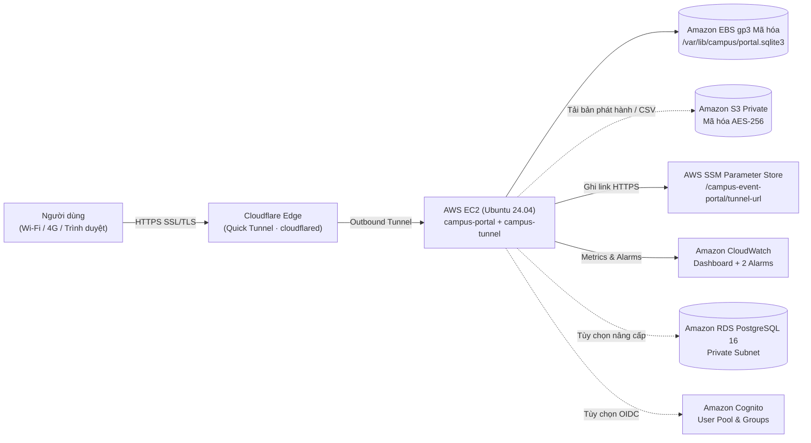

<div align="center">

# 🎓 Campus Event Portal

**Hệ thống Quản lý & Đăng ký Sự kiện Đại học theo kiến trúc Multi-Cloud (AWS + Cloudflare)**

[](#8-kiểm-thử-tự-động--benchmark-tải-cao)
[](#2-kiến-trúc-hệ-thống-multi-cloud)
[](#3-hệ-thống-phân-quyền--bảo-mật)
[](.github/workflows/ci-cd.yml)

[Truy cập Web Demo](#-truy-cập-bản-demo-trực-tuyến) • [Tài khoản đăng nhập](#-tài-khoản-nhà-trường-cấp-sẵn) • [Kiến trúc Cloud](#2-kiến-trúc-hệ-thống-multi-cloud) • [Chạy trên máy](#5-hướng-dẫn-chạy-trên-máy-cá-nhân) • [Triển khai AWS](#6-triển-khai-tự-động-lên-aws--cloudflare)

</div>

---

## 🌐 Truy cập bản Demo trực tuyến

Hệ thống đang vận hành **24/7 trên AWS EC2 kết hợp Cloudflare HTTPS Tunnel** (truy cập được từ mọi mạng Wi-Fi và 4G/5G):

| Dịch vụ | Đường dẫn |
| :--- | :--- |
| **Trang chủ Campus Event Portal** | https://city-generous-printed-strengthening.trycloudflare.com |
| **Kiểm tra trạng thái (`/readyz`)** | https://city-generous-printed-strengthening.trycloudflare.com/readyz |
| **API Danh sách sự kiện (`/api/events`)** | https://city-generous-printed-strengthening.trycloudflare.com/api/events |

> 💡 **Lưu ý:** Địa chỉ `http://127.0.0.1:4173/` ở [Mục 5](#5-hướng-dẫn-chạy-trên-máy-cá-nhân) chỉ hoạt động khi bạn tự chạy máy chủ trên máy tính cá nhân bằng lệnh `py -3 server.py`.

---

## 🔑 Tài khoản Nhà trường cấp sẵn

Chức năng tự đăng ký tài khoản công khai đã được tắt (`403 SIGNUP_DISABLED`). Toàn bộ người dùng đăng nhập bằng tài khoản do nhà trường cấp:

| Vai trò | Mã tài khoản | Email đăng nhập | Mật khẩu |
| :--- | :--- | :--- | :--- |
| **100 Sinh viên** | `stu-10001` → `stu-10100` | `student10001@example.test` → `student10100@example.test` | `Stu-CpAeXJfXqnGfuk` |
| **Ban tổ chức (CLB Công nghệ)** | `org-1` | `organizer@example.test` | `Org-4f5Etiyw6Mf3feCa` |
| **Ban tổ chức (Ban hoạt động SV)** | `org-2` | `organizer2@example.test` | `Org-4f5Etiyw6Mf3feCa` |
| **Quản trị viên** | `admin-1` | `admin@example.test` | `Adm-NnrWA5n8BjiHLT9u` |

> *(Dữ liệu tổng hợp phục vụ demo đồ án môn học. Sau khi đăng nhập, sinh viên có thể bấm vào tên tài khoản ở góc phải để **Đổi mật khẩu**.)*

---

## 1. Tính năng chính

### 👨‍🎓 Dành cho Sinh viên
- Tìm kiếm, lọc theo chủ đề/hình thức, sắp xếp sự kiện theo ngày diễn ra hoặc số chỗ còn lại.
- Đăng ký giữ chỗ & nhận mã biên nhận tức thời; xem lịch sử và hủy đăng ký trả chỗ.
- Chống đăng ký quá chỗ khi tải cao (**100 yêu cầu đồng thời tranh 20 chỗ** chỉ đúng 20 sinh viên giữ chỗ thành công) và hỗ trợ **`Idempotency-Key`** chống trừ chỗ 2 lần khi rớt mạng.
- Tự **Đổi mật khẩu** ngay trong phần hồ sơ cá nhân (`POST /api/auth/change-password`).

### 📋 Dành cho Ban tổ chức
- Tạo & xuất bản sự kiện mới, chỉnh sửa thông tin mô tả chi tiết sự kiện do mình phụ trách.
- Theo dõi sức chứa theo thời gian thực, tra cứu danh sách sinh viên tham gia (roster) và **tải file CSV** (UTF-8 BOM chuẩn Excel tiếng Việt, chống CSV formula injection, hỗ trợ lưu trữ trên **Amazon S3**).

### 🛡️ Dành cho Quản trị viên (Admin)
- **Quản lý Sinh viên (`#/students`):** Xem danh sách, **Thêm mới**, **Chỉnh sửa thông tin**, **Đặt lại mật khẩu** và **Xóa sinh viên** (tự động hoàn lại chỗ trống ở các sự kiện sinh viên đó đang giữ chỗ).
- **Quản lý Sự kiện (`#/organizer`):** **Tạo**, **Chỉnh sửa**, **Xóa sự kiện**, **Thêm trực tiếp sinh viên thật vào sự kiện** và **Gỡ sinh viên khỏi sự kiện**.
- **100% Dữ liệu thật:** Không tạo dữ liệu `Sinh viên giả`; số lượng đăng ký trên mọi sự kiện phản ánh chính xác các sinh viên thật trong hệ thống.

### 🎨 Giao diện hiện đại (Modern Indigo & Slate)
- Thiết kế chuyên nghiệp bằng tông màu **Cobalt Blue & Slate** cùng bộ font tối ưu tiếng Việt **`Plus Jakarta Sans`** và **`Be Vietnam Pro`** (`dist/theme-modern.css`), hiển thị mượt trên cả máy tính và điện thoại.

---

## 2. Kiến trúc hệ thống (Multi-Cloud)



---

## 3. Hệ thống phân quyền & Bảo mật

| Vai trò (`role`) | Nhóm AWS Cognito | Quyền được phép | Chặn truy cập (`401` / `403`) |
| :--- | :--- | :--- | :--- |
| **`student`** | `Students` | Xem sự kiện, đăng ký/hủy vé của mình, xem biên nhận, đổi mật khẩu cá nhân. | Không tạo/sửa/xóa sự kiện, không xem roster/CSV, không quản lý sinh viên, không hủy vé người khác. |
| **`organizer`** | `Organizers` | Tạo sự kiện; sửa, xem roster & xuất CSV **chỉ cho sự kiện của mình**; đổi mật khẩu. | Không xóa sự kiện, không sửa/xem sự kiện của người khác, không quản lý sinh viên. |
| **`administrator`** | `Administrators` | Toàn quyền **Thêm/Sửa/Xóa sinh viên**, **Thêm/Sửa/Xóa mọi sự kiện**, **Thêm/Gỡ sinh viên trong sự kiện**, xuất CSV toàn hệ thống. | — |

**Các lớp bảo mật đã cài đặt:**
- **Mật khẩu:** Băm một chiều bằng `scrypt` kèm muối ngẫu nhiên (`backend/accounts.py`).
- **Phiên & Chống giả mạo:** Cookie `HttpOnly; SameSite=Strict; Secure` (qua HTTPS), kiểm tra `Origin`, `Sec-Fetch-Site` và mã **`X-CSRF-Token`**.
- **Chống dò mật khẩu & Chống giả danh:** Rate limit theo địa chỉ IP; tự động từ chối `X-Demo-User` khi truy cập qua Proxy/Internet (`401`).
- **Hạ tầng AWS:** IAM Role tối thiểu quyền (Least Privilege), Security Group chặn `0.0.0.0/0`, ổ cứng EBS mã hóa, S3 chặn truy cập công khai và mã hóa `AES-256`.

---

## 4. Cấu trúc thư mục dự án

<details>
<summary><b>📂 Bấm để xem chi tiết cấu trúc thư mục</b></summary>

```text
portal/
├── server.py                     # Máy chủ HTTP API (SQLite & PostgreSQL, bảo mật Proxy/CSRF/RBAC)
├── fixtures.json                 # Dữ liệu khởi tạo (100 sinh viên, 2 BTC, 1 Admin, 6 sự kiện)
├── requirements.txt              # Thư viện Python (psycopg, PyJWT[crypto], boto3...)
├── package.json                  # Cấu hình chạy & kiểm thử Frontend (Node.js)
├── BAT-DAU.bat                   # File chạy nhanh bằng 1 cú bấm đúp trên Windows
├── backend/
│   ├── 001_schema.sql            # Lược đồ CSDL + Trigger chặn vượt sức chứa ở tầng DB
│   ├── db.py                     # Giao dịch SQLite WAL (BEGIN IMMEDIATE)
│   ├── postgres.py               # Giao dịch PostgreSQL / Amazon RDS (SELECT FOR UPDATE)
│   ├── accounts.py               # Xác thực scrypt, phiên đăng nhập, đổi mật khẩu & rate limit
│   ├── account_validation.py     # Kiểm tra hợp lệ Email và CSRF Token
│   ├── admin.py                  # Nghiệp vụ Quản trị (CRUD sinh viên, xóa sự kiện, thêm/gỡ roster)
│   ├── auth.py                   # Xác thực AWS Cognito JWT (RS256/JWKS) & ánh xạ vai trò
│   ├── event_updates.py          # Chỉnh sửa sự kiện có kiểm tra chủ sở hữu & idempotency
│   ├── storage.py                # Lưu trữ file CSV xuất danh sách (cục bộ hoặc Amazon S3)
│   ├── backup.py                 # Sao lưu & khôi phục dữ liệu có kiểm tra mã băm SHA-256
│   ├── telemetry.py              # Structured JSON logging, X-Request-Id & số liệu hệ thống
│   └── settings.py               # Đọc cấu hình môi trường & AWS Secrets Manager
├── dist/                         # Giao diện Web (HTML/CSS/JS thuần)
│   ├── index.html
│   ├── styles.css
│   ├── theme-modern.css          # Theme Modern Indigo & Slate + font tiếng Việt
│   └── js/                       # app.js, api.js, cognito-auth.js, data.js, utils.js
├── deploy/aws/
│   ├── campus-ec2.yaml           # AWS CloudFormation IaC (EC2, EBS, CloudWatch, Cloudflare, Cognito, RDS)
│   ├── deploy-aws.ps1            # Script PowerShell đóng gói & triển khai tự động 1 lệnh
│   └── backup-restore.ps1        # Script sao lưu, chụp EBS Snapshot & Rollback CloudFormation
├── scripts/
│   ├── benchmark_e.py            # Benchmark tải cao 100 luồng & tiêm lỗi mạng (Phần E)
│   ├── set_account_password.py   # Công cụ đặt mật khẩu theo tài khoản hoặc theo vai trò (--role)
│   └── start.cjs                 # Script khởi chạy qua npm start
├── tests/                        # 46 bài test Python + 20 bài test Node.js
└── .github/workflows/ci-cd.yml   # Pipeline CI/CD tự động trên GitHub Actions
```

</details>

---

## 5. Hướng dẫn chạy trên máy cá nhân

### Yêu cầu
- **Python 3.10+** (bắt buộc) và **Node.js 20+** (nếu dùng `npm` / chạy test Frontend).

### Bước 1: Khởi tạo dữ liệu & cấp mật khẩu tài khoản mẫu
```powershell
py -3 server.py seed
py -3 scripts/set_account_password.py --role student
py -3 scripts/set_account_password.py --role organizer
py -3 scripts/set_account_password.py --role administrator
```

### Bước 2: Khởi động máy chủ
```powershell
# Chạy trực tiếp bằng Python (hoặc bấm đúp .\BAT-DAU.bat / chạy npm.cmd start)
py -3 server.py
```

Mở trình duyệt tại **http://127.0.0.1:4173/** *(nhấn `Ctrl + C` để dừng; không mở trực tiếp file `dist/index.html`)*.

---

## 6. Triển khai tự động lên AWS + Cloudflare

### Triển khai 1 lệnh (EC2 + Encrypted EBS + CloudWatch + Cloudflare HTTPS)
Yêu cầu đã cài **AWS CLI** và cấu hình `aws configure`:

```powershell
.\deploy\aws\deploy-aws.ps1 `
  -Region ap-southeast-2 `
  -StudentPassword "MatKhauSinhVien>=12KyTu" `
  -OrganizerPassword "MatKhauBanToChuc>=12KyTu" `
  -AdminPassword "MatKhauQuanTriVien>=12KyTu"
```

<details>
<summary><b>⚙️ Các lệnh vận hành AWS nâng cao (Lấy link HTTPS, bật Cognito/RDS, Xóa tài nguyên)</b></summary>

**Lấy lại link Cloudflare HTTPS hiện tại từ AWS SSM:**
```powershell
aws ssm get-parameter --name /campus-event-portal/tunnel-url --region ap-southeast-2 --query Parameter.Value --output text
```

**Triển khai kèm Amazon Cognito và/hoặc Amazon RDS PostgreSQL 16:**
```powershell
.\deploy\aws\deploy-aws.ps1 `
  -Region ap-southeast-2 `
  -ProvisionCognito `
  -ProvisionRds `
  -DbMasterPassword "MatKhauRDSManh2026!"
```

**Xóa toàn bộ tài nguyên AWS sau khi demo xong (tránh phát sinh chi phí):**
```powershell
aws cloudformation delete-stack --stack-name campus-event-portal --region ap-southeast-2
aws cloudformation wait stack-delete-complete --stack-name campus-event-portal --region ap-southeast-2
aws ssm delete-parameter --name /campus-event-portal/tunnel-url --region ap-southeast-2
aws s3 rb s3://TEN-BUCKET-S3-CUA-BAN --force --region ap-southeast-2
```

</details>

---

## 7. Sao lưu, Khôi phục & Rollback

```powershell
# Kiểm toán toàn vẹn CSDL, sao lưu & khôi phục có xác minh SHA-256
py -3 server.py audit
py -3 server.py backup --file campus-backup.json
py -3 server.py restore --file campus-backup.json

# Tiện ích vận hành AWS (Chụp EBS Snapshot / Rollback CloudFormation)
.\deploy\aws\backup-restore.ps1 -Action ebs-snapshot -Region ap-southeast-2
.\deploy\aws\backup-restore.ps1 -Action cfn-rollback -Region ap-southeast-2
```

---

## 8. Kiểm thử tự động & Benchmark tải cao

```powershell
py -3 -m pip install -r requirements.txt
py -3 -m unittest discover -s tests -p "test_*.py" -v
npm.cmd test
npm.cmd run check
py -3 scripts/benchmark_e.py
```

| Hạng mục kiểm thử | Kết quả | Chi tiết |
| :--- | :---: | :--- |
| **Python Backend, Admin, Accounts, Security & IaC** | ✅ **46 / 46 PASS** | Đầy đủ CRUD Admin, đổi mật khẩu, RBAC, Proxy HTTPS, Cognito JWT, Backup/Restore, CloudFormation IaC. |
| **Node.js Frontend & Client Adapter** | ✅ **20 / 20 PASS** | Kiểm tra cú pháp, escape XSS, CSV BOM, Cookie/CSRF, Idempotency. |
| **Benchmark E1 (100 luồng tranh 20 chỗ)** | ✅ **PASS** | Đúng `20` HTTP `201`, `80` HTTP `409 EVENT_FULL`, `0` lỗi `5xx` (`p50 = 111.4 ms`, `p95 = 609.1 ms`). |
| **Benchmark E2 (Tiêm lỗi mất phản hồi + 10x retry)** | ✅ **PASS** | `10/10` trả `201` với `Idempotency-Replayed: true`, không trừ thêm chỗ. |
| **Benchmark E3 (20 hủy đồng thời + xung đột khóa)** | ✅ **PASS** | `20/20` trả `200`, xung đột trả `409 IDEMPOTENCY_CONFLICT`, `audit` trước & sau đều `ok = true`. |

---

## 9. Tài liệu báo cáo đính kèm

| Tài liệu | Nội dung |
| :--- | :--- |
| [REPORT-B.md](REPORT-B.md) | Báo cáo kiểm toán lỗi hệ thống, tranh chấp dữ liệu & cách khắc phục (Phần B). |
| [REPORT-C-D-E.md](REPORT-C-D-E.md) | Báo cáo kiến trúc Cloud, bảo mật, Backup/Restore/Rollback & phân tích Benchmark (Phần C, D, E). |
| [BENCHMARK-E-RESULTS.json](BENCHMARK-E-RESULTS.json) | Dữ liệu JSON đo độ trễ và kiểm toán toàn vẹn Phần E. |
| [TEST-RESULTS.txt](TEST-RESULTS.txt) | Tổng hợp kết quả kiểm thử tự động mới nhất. |
| [REFERENCE.md](REFERENCE.md) & [KIEM-TRA.md](KIEM-TRA.md) | Dữ liệu tham chiếu và kịch bản kiểm tra chức năng. |
