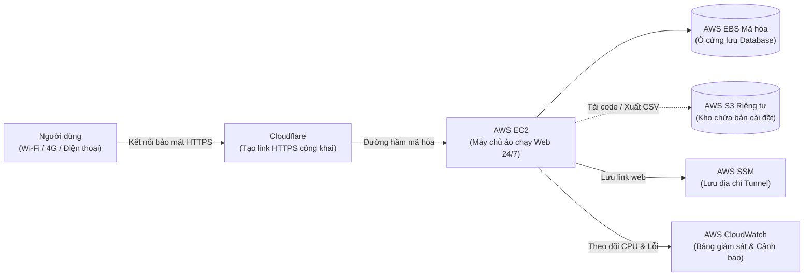

<div align="center">

# 🎓 Campus Event Portal

**Website Quản lý & Đăng ký Sự kiện Đại học — Chạy trực tuyến trên AWS + Cloudflare**

[](#6-kết-quả-kiểm-thử--đo-chịu-tải)
[](#3-hệ-thống-đám-mây-aws--cloudflare-dùng-để-làm-gì)
[](#2-hướng-dẫn-dùng-thử-theo-3-vai-trò)
[](.github/workflows/ci-cd.yml)

[Mở Web Demo](#-1-mở-web-chạy-trực-tuyến-247) • [Tài khoản đăng nhập](#-tài-khoản-dùng-thử-do-nhà-trường-cấp) • [Cách dùng 3 vai trò](#2-hướng-dẫn-dùng-thử-theo-3-vai-trò) • [Giải thích AWS & Cloudflare](#3-hệ-thống-đám-mây-aws--cloudflare-dùng-để-làm-gì) • [Chạy trên máy cá nhân](#4-hướng-dẫn-chạy-trên-máy-tính-cá-nhân)

</div>

---

## Giới thiệu ngắn gọn

**Campus Event Portal** là trang web giúp **Sinh viên** xem lịch và đăng ký tham gia các sự kiện trong trường đại học, giúp **Ban tổ chức (CLB)** đăng bài và xuất danh sách điểm danh, và giúp **Quản trị viên (Nhà trường)** quản lý toàn bộ tài khoản sinh viên lẫn sự kiện.

Điểm nổi bật của dự án là **đã triển khai chạy thực tế 24/7 trên đám mây (AWS + Cloudflare HTTPS)**, đảm bảo khi **100 sinh viên bấm đăng ký cùng một lúc vào sự kiện chỉ có 20 chỗ**, hệ thống chỉ duyệt đúng **20 người**, không bao giờ bị âm chỗ hay đặt trùng vé.

---

## 🌐 1. Mở Web chạy trực tuyến 24/7

Bạn và giảng viên có thể bấm trực tiếp vào đường link dưới đây bằng **mọi mạng Wi-Fi hoặc 4G/5G trên điện thoại** (không cần bật máy tính cá nhân):

- **Trang chủ Web:** https://city-generous-printed-strengthening.trycloudflare.com
- **Kiểm tra máy chủ đang hoạt động:** https://city-generous-printed-strengthening.trycloudflare.com/readyz
- **Xem dữ liệu danh sách sự kiện (API):** https://city-generous-printed-strengthening.trycloudflare.com/api/events

### 🔑 Tài khoản dùng thử (do Nhà trường cấp sẵn)

> Vì tài khoản sinh viên và cán bộ do Nhà trường quản lý nên hệ thống **không có nút tự đăng ký tài khoản mới**. Bạn chỉ cần bấm nút **Đăng nhập** ở góc trên bên phải và nhập một trong các tài khoản sau:

| Vai trò | Số lượng | Email đăng nhập | Mật khẩu |
| :--- | :--- | :--- | :--- |
| **Sinh viên** | 100 tài khoản (`stu-10001` → `stu-10100`) | `student10001@example.test` *(hoặc từ `10001` đến `10100`)* | `Stu-CpAeXJfXqnGfuk` |
| **Ban tổ chức (CLB Công nghệ)** | 1 tài khoản (`org-1`) | `organizer@example.test` | `Org-4f5Etiyw6Mf3feCa` |
| **Ban tổ chức (Ban hoạt động SV)** | 1 tài khoản (`org-2`) | `organizer2@example.test` | `Org-4f5Etiyw6Mf3feCa` |
| **Quản trị viên (Nhà trường)** | 1 tài khoản (`admin-1`) | `admin@example.test` | `Adm-NnrWA5n8BjiHLT9u` |

---

## 2. Hướng dẫn dùng thử theo 3 vai trò

### 👨‍🎓 Vai trò 1: Sinh viên (`student10001@example.test`)
1. Vào mục **Khám phá** để tìm kiếm, lọc theo chủ đề hoặc xem số chỗ còn trống của từng sự kiện.
2. Bấm vào một sự kiện còn chỗ (ví dụ *Cloud Computing*) → bấm **Đăng ký tham gia** → hệ thống cấp ngay **Mã biên nhận** và tự động trừ 1 chỗ trống.
3. Vào mục **Đăng ký của tôi** để xem lại các sự kiện đã đặt hoặc bấm **Hủy đăng ký** (chỗ trống sẽ được trả lại ngay cho sinh viên khác).
4. Bấm vào tên của bạn ở góc trên bên phải → chọn **Đổi mật khẩu** nếu muốn đổi sang mật khẩu riêng.

### 📋 Vai trò 2: Ban tổ chức (`organizer@example.test`)
1. Đăng nhập rồi vào mục **Ban tổ chức** trên thanh menu.
2. Bấm **Tạo sự kiện** để đăng một sự kiện mới lên trang chủ, hoặc bấm **Chỉnh sửa sự kiện** để cập nhật thông tin.
3. Xem số lượng sinh viên đã đăng ký theo thời gian thực và bấm **Tải danh sách CSV** để tải file danh sách điểm danh mở được ngay bằng Excel (không bị lỗi phông tiếng Việt).
4. **Quy tắc bảo mật:** Ban tổ chức chỉ xem và sửa được **sự kiện do CLB mình tạo**, không thể can thiệp vào sự kiện của CLB khác hay danh sách sinh viên của trường.

### 🛡️ Vai trò 3: Quản trị viên / Admin (`admin@example.test`)
1. **Mục Quản lý sự kiện:** Có toàn quyền **Tạo**, **Chỉnh sửa**, **Xóa sự kiện**, bấm **`+ Thêm sinh viên`** để ghi danh trực tiếp sinh viên có sẵn vào sự kiện, hoặc bấm **`Gỡ khỏi sự kiện`** để hủy vé và trả lại chỗ.
2. **Mục Quản lý sinh viên:** Xem toàn bộ danh sách sinh viên thật trong trường, **Thêm sinh viên mới**, **Sửa thông tin / đặt lại mật khẩu**, hoặc **Xóa sinh viên** (nếu sinh viên đó đang giữ vé sự kiện, hệ thống sẽ tự động hoàn lại chỗ trống).
3. **100% Dữ liệu thật:** Toàn bộ danh sách người tham gia trong các sự kiện đều là sinh viên thật trong hệ thống, không dùng dữ liệu ảo.

---

## 3. Hệ thống Đám mây (AWS + Cloudflare) dùng để làm gì?

Thay vì chỉ chạy trên máy cá nhân (`localhost` — tắt máy là web sập), dự án kết hợp **AWS Cloud** và **Cloudflare** để chạy thực tế trên Internet:



| Dịch vụ Cloud | Hiểu đơn giản dùng để làm gì? |
| :--- | :--- |
| **Amazon EC2** | Là chiếc **máy chủ ảo (Ubuntu Linux)** bật 24/7 trên mây để chạy Web và API, bạn tắt máy tính cá nhân web vẫn chạy bình thường. |
| **Amazon EBS (`gp3` mã hóa)** | Là **ổ cứng rời được mã hóa** gắn vào máy chủ để lưu dữ liệu sinh viên và vé sự kiện. Dù máy chủ có khởi động lại thì dữ liệu vẫn còn nguyên, không bị mất. |
| **Amazon S3 (Private)** | Là **kho lưu trữ đám mây riêng tư** chứa gói mã nguồn đã đóng gói để máy chủ tự động tải về cài đặt (và hỗ trợ lưu file CSV xuất ra). |
| **AWS CloudFormation** | Là **bản thiết kế hạ tầng tự động** (`deploy/aws/campus-ec2.yaml`). Chỉ cần chạy 1 lệnh, AWS tự động dựng xong toàn bộ mạng, máy chủ, ổ cứng và giám sát thay vì phải bấm chuột thủ công. |
| **Amazon CloudWatch** | Là **màn hình theo dõi sức khỏe máy chủ** (xem biểu đồ CPU, lượng truy cập và tự động báo động nếu máy chủ bị quá tải hoặc treo). |
| **Cloudflare Tunnel** | Đứng trước máy chủ AWS để cấp **đường link có ổ khóa bảo mật `HTTPS`** miễn phí, giúp mọi người dù dùng Wi-Fi hay 4G đều vào được web mà không phải mở toang cổng tường lửa trên AWS. |
| **Amazon Cognito & RDS PostgreSQL** | *(Đã tích hợp sẵn trong code để mở rộng)* Cho phép bật thêm dịch vụ đăng nhập tập trung của AWS và cơ sở dữ liệu PostgreSQL riêng khi cần mở rộng cho hàng chục nghìn sinh viên. |

---

## 4. Hướng dẫn chạy trên máy tính cá nhân

Nếu muốn chạy thử ngoại tuyến trên máy tính của bạn (chỉ cần cài sẵn **Python 3.10 trở lên**):

1. Mở **PowerShell** (hoặc Terminal) ngay tại thư mục `portal`.
2. Tạo dữ liệu mẫu và đặt mật khẩu cho các tài khoản (chỉ cần làm 1 lần đầu):
   ```powershell
   py -3 server.py seed
   py -3 scripts/set_account_password.py --role student
   py -3 scripts/set_account_password.py --role organizer
   py -3 scripts/set_account_password.py --role administrator
   ```
3. Chạy máy chủ web:
   ```powershell
   py -3 server.py
   ```
   *(Hoặc bấm đúp vào file `BAT-DAU.bat` trên Windows).*
4. Mở trình duyệt và vào địa chỉ **http://127.0.0.1:4173/**. Khi muốn tắt máy chủ, bấm `Ctrl + C`.

> ⚠️ Lưu ý: Không bấm mở trực tiếp file `dist/index.html` vì giao diện cần kết nối với máy chủ Python ở Bước 3 mới tải được dữ liệu.

---

## 5. An toàn dữ liệu & Xử lý sự cố

Dự án đã xử lý sẵn các tình huống thực tế thường gặp khi nhiều sinh viên truy cập cùng lúc:
- **Chống đăng ký vượt quá sức chứa:** Dùng khóa giao dịch chặt trong CSDL (cả SQLite lẫn PostgreSQL) kèm ràng buộc tự động chặn khi hết chỗ.
- **Chống mất mạng / bấm đúp bị đặt 2 vé:** Mỗi lần bấm đăng ký đều gắn một mã yêu cầu duy nhất; nếu mạng chập chờn và người dùng bấm thử lại, hệ thống trả về đúng vé đã lưu chứ không trừ thêm chỗ.
- **Bảo mật mật khẩu & phiên đăng nhập:** Mật khẩu không bao giờ lưu dạng chữ thường (được mã hóa một chiều), phiên đăng nhập dùng Cookie bảo mật ẩn khỏi JavaScript, chống gửi lệnh giả mạo từ trang web lạ và chặn đoán mật khẩu quá nhiều lần.
- **Sao lưu & khôi phục dữ liệu:** Có lệnh xuất bản sao lưu kèm mã kiểm tra toàn vẹn (`SHA-256`) và chụp ảnh ổ cứng trên AWS để khôi phục nhanh khi gặp sự cố.

---

## 6. Kết quả kiểm thử & Đo chịu tải

Hệ thống được kiểm thử tự động hoàn toàn (kể cả tự động chạy trên **GitHub Actions** mỗi khi cập nhật code):

| Bài kiểm tra | Kết quả | Ý nghĩa dễ hiểu |
| :--- | :---: | :--- |
| **Kiểm thử Backend, Quản trị & Bảo mật (Python)** | ✅ **46 / 46 Đạt** | Đảm bảo phân quyền đúng, CRUD Admin chuẩn, đổi mật khẩu, sao lưu/khôi phục và cấu hình AWS hợp lệ. |
| **Kiểm thử Giao diện (Node.js)** | ✅ **20 / 20 Đạt** | Giao diện không lỗi cú pháp, chống chèn mã độc (XSS), xuất file CSV tiếng Việt chuẩn. |
| **Bài test 100 người tranh 20 chỗ cùng lúc** | ✅ **Đạt** | Đúng **20 người thành công**, **80 người nhận báo hết chỗ**, **0 lỗi máy chủ**, không âm chỗ. |
| **Bài test rớt mạng giữa chừng & thử lại 10 lần** | ✅ **Đạt** | Cả **10 lần thử lại** đều trả về đúng 1 mã vé duy nhất, không bị trừ thêm chỗ. |
| **Bài test 20 lượt hủy vé cùng lúc** | ✅ **Đạt** | Chỉ hoàn lại đúng 1 chỗ, dữ liệu trước và sau kiểm tra đều khớp 100%. |

---

## 7. Tài liệu & Lệnh kỹ thuật nâng cao (dành cho lập trình viên)

<details>
<summary><b>🚀 Lệnh triển khai lên AWS, lấy lại link HTTPS, sao lưu & xóa server AWS</b></summary>

**Triển khai tự động lên AWS + Cloudflare HTTPS** *(cần cấu hình `aws configure` trước)*:
```powershell
.\deploy\aws\deploy-aws.ps1 `
  -Region ap-southeast-2 `
  -StudentPassword "MatKhauSinhVien>=12KyTu" `
  -OrganizerPassword "MatKhauBanToChuc>=12KyTu" `
  -AdminPassword "MatKhauQuanTriVien>=12KyTu"
```

**Lấy lại đường link Cloudflare HTTPS mới nhất từ AWS:**
```powershell
aws ssm get-parameter --name /campus-event-portal/tunnel-url --region ap-southeast-2 --query Parameter.Value --output text
```

**Chạy toàn bộ bộ kiểm thử & benchmark tải cao:**
```powershell
py -3 -m pip install -r requirements.txt
py -3 -m unittest discover -s tests -p "test_*.py" -v
npm.cmd test
npm.cmd run check
py -3 scripts/benchmark_e.py
```

**Sao lưu, kiểm tra toàn vẹn & khôi phục dữ liệu:**
```powershell
py -3 server.py audit
py -3 server.py backup --file campus-backup.json
py -3 server.py restore --file campus-backup.json
.\deploy\aws\backup-restore.ps1 -Action ebs-snapshot -Region ap-southeast-2
```

**Xóa toàn bộ máy chủ & dữ liệu trên AWS khi kết thúc môn học (tránh tốn phí):**
```powershell
aws cloudformation delete-stack --stack-name campus-event-portal --region ap-southeast-2
aws cloudformation wait stack-delete-complete --stack-name campus-event-portal --region ap-southeast-2
aws ssm delete-parameter --name /campus-event-portal/tunnel-url --region ap-southeast-2
aws s3 rb s3://TEN-BUCKET-S3-CUA-BAN --force --region ap-southeast-2
```

</details>

<details>
<summary><b>📂 Cấu trúc các thư mục chính trong mã nguồn</b></summary>

```text
portal/
├── server.py                   # Máy chủ web & xử lý toàn bộ API
├── fixtures.json               # Dữ liệu khởi tạo (100 sinh viên, 2 BTC, 1 Admin, 6 sự kiện)
├── BAT-DAU.bat                 # File bấm đúp chạy nhanh trên Windows
├── backend/                    # Code xử lý CSDL, tài khoản, phân quyền, quản trị Admin, sao lưu
├── dist/                       # Giao diện trang web (HTML, CSS, theme-modern.css, JavaScript)
├── deploy/aws/                 # Cấu hình hạ tầng AWS (campus-ec2.yaml) & script triển khai tự động
├── scripts/                    # Công cụ đặt mật khẩu & chạy benchmark đo chịu tải
├── tests/                      # 46 bài kiểm thử Python + 20 bài kiểm thử Node.js
└── .github/workflows/ci-cd.yml # Tự động chạy kiểm thử trên GitHub Actions
```

</details>

### 📑 Các file báo cáo chi tiết có sẵn trong dự án
- [REPORT-B.md](REPORT-B.md) — Báo cáo rà soát và sửa các lỗi xử lý đồng thời / dữ liệu (Phần B).
- [REPORT-C-D-E.md](REPORT-C-D-E.md) — Báo cáo kiến trúc Cloud, bảo mật, vận hành sao lưu và phân tích chịu tải (Phần C, D, E).
- [BENCHMARK-E-RESULTS.json](BENCHMARK-E-RESULTS.json) & [TEST-RESULTS.txt](TEST-RESULTS.txt) — Số liệu đo thực tế và kết quả kiểm thử.
- [KIEM-TRA.md](KIEM-TRA.md) & [REFERENCE.md](REFERENCE.md) — Kịch bản kiểm tra từng chức năng.
